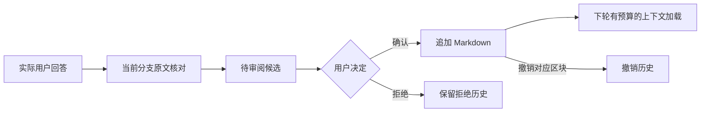

# 可审阅长期记忆

2026-09-30。目标：把“不要误记用户事实”的提示词约定转为有来源、有状态、可审阅的更新流程，同时保留七份 Markdown 的可读性和迁移能力。

## 用户流程

1. 用户要求记住某件事，或完成学习/面试复盘。
2. Agent 读取对应 Memory，调用 `bt_memory_propose`，提交正文、类别、保留理由及当前对话的原文引用。
3. Extension 在 `getBranch()` 中核对引用与消息角色，捕获实际条目 ID、Session ID、模式和工作目录。不存在的引用拒绝入队。
4. 候选进入 `.bt/memory-review/state.json`，状态为 pending；不写 Markdown、不加入下轮自动上下文。
5. 用户在 Memory → 候选与历史检查来源，确认/拒绝。CLI 的 `/memory-review` 也支持相同操作。
6. 确认后追加带唯一 ID 的记录；下轮既有加载逻辑读取已确认 Markdown。拒绝只改变队列。撤销移除该原样区块，保留其他历史和之后的人工记录。



## 数据边界

- 类型：fact / user_view / ai_explanation / shared_question。用户事实和观点至少要有用户原文，AI解释一直保留待验证标签。
- 来源：实际 Session、模式、工作目录、消息条目 ID 与引用。保存引用快照，删除原 Session 后引用仍可查阅；暂未提供一键跳转源消息。
- 知识地图：必须带 assessment，包括 concept、level、basis、gaps、nextQuestion；至少一条用户回答，L3/L4 至少两条不同用户原文。这只约束记录结构，不能证明回答正确或评估准确。
- 来源核对在 Extension 层完成；共享存储信任该调用方提供的来源，不自行加载 Session。桌面 POST 仅接受审阅动作，不提供任意候选创建入口。
- 旧 Markdown 仍可加载，不批量转换旧记录。旧记录的类型与来源不会自动补齐。
- 每条正文最多 4000 字符，最多 6 条证据，每条证据最多 1000 字符；审阅队列总记录上限 2000。无自动合并、遗忘、归档、召回排序或后台记忆任务。

## 一致性与恢复

- 独占目录锁协调共享此实现的 BT CLI/桌面进程。锁被占用时返回冲突，不并发覆盖。
- revision 阻止旧界面提交；候选保留生成时的目标文件 SHA-256，审批前改变文件则返回 409，须拒绝并基于最新内容重新提出。
- 文件用临时文件、flush、rename 原子替换。事务意图先持久化，再写 Markdown、审阅状态，最后删除意图。
- 下次读写发现中断意图时，依据前后哈希与 revision 完成未结束的操作；第三方修改发生冲突时保留意图并拒绝覆盖。
- undo 只移除完整匹配的单个区块。已人工修改该区块时拒绝撤销，保留文件供用户处理。
- 异常进程退出可能遗留锁。需先退出所有 BT 进程、备份 `.bt/memory-review/`，再移除 `lock/`；下一次调用会尝试事务恢复。没有自动判断僵死锁，避免错误抢占仍活跃的写入。
- 这不是数据库级的跨文件事务或文件系统沙箱。外部编辑器不遵守锁，仍需避免在审批瞬间并发编辑同一文件；目录 rename 的断电语义依赖 OS/文件系统。

## 运行与测试

```powershell
.\scripts\npm.ps1 run test:memory
.\scripts\npm.ps1 test
.\scripts\npm.ps1 run build:desktop
.\scripts\npm.ps1 run test:desktop
.\scripts\npm.ps1 run test:memory-ui
```

测试使用临时中性 Memory、本地模型 fixture 和无头 Edge，不访问个人凭据。UI 示例截图由隔离资料生成，保存于 `docs/assets/memory-review-fixture.png`，不代表真实用户知识等级。

## 安全与效果限制

原生 write/edit 对 Memory 和审阅目录的直接写入被阻止。Shell、文件别名和其他自定义工具仍可能绕过应用层约定，模型不等于受限进程；这不是权限隔离。用户确认是界面操作边界，不是防御恶意本机程序的认证机制。

引用存在不等于正文语义正确。事实抽取、知识评估、模式行为遵守程度都需要真实模型评测。当前测试验证工具链与持久化，不报告学习提升、记忆准确率或模式成功率。
